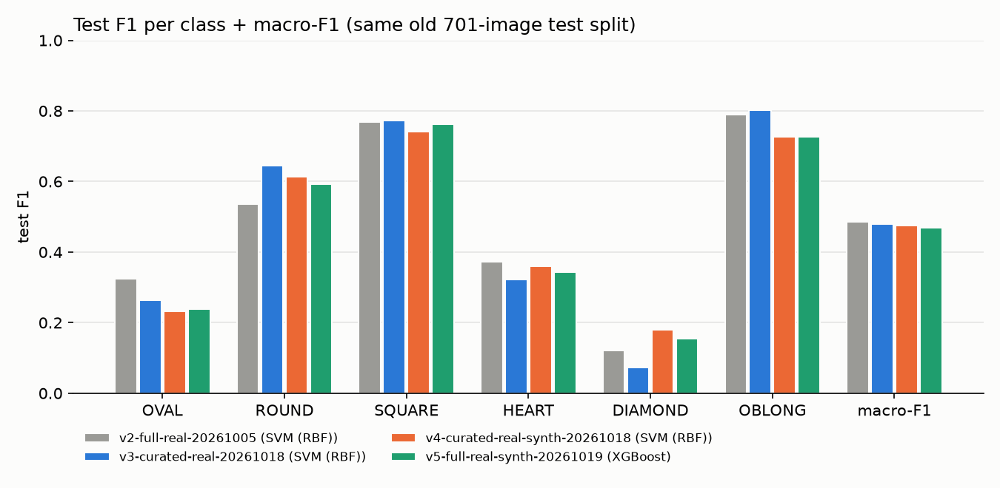

# Face-shape classifiers - curated dataset comparison (plan 2026-10-18)

Generated 2026-10-19 by `make curated-compare` from the saved `metrics_<algo>.json` of each run (no new test prediction). Do not edit by hand.

Runs (best model of each run by CV macro-F1, `training.selection` - not by test numbers):

- **v2-full-real-20261005**: data `data/datasets/full-real`, reports `reports/runs/v2-full-real-20261005`
- **v3-curated-real-20261018**: data `data/datasets/curated-real`, reports `reports/runs/v3-curated-real-20261018`
- **v4-curated-real-synth-20261018**: data `data/datasets/curated-real-synth`, reports `reports/runs/v4-curated-real-synth-20261018`
- **v5-full-real-synth-20261019**: data `data/datasets/full-real-synth`, reports `reports/runs/v5-full-real-synth-20261019`

## Overall (test)

| run | best model | macro F1 | accuracy | DIAMOND F1 | DIAMOND predicted (true n=19) | test Brier |
|---|---|---|---|---|---|---|
| v2-full-real-20261005 | SVM (RBF) | 0.485 | 0.541 | 0.121 | 47 | 0.1013 |
| v3-curated-real-20261018 | SVM (RBF) | 0.480 | 0.553 | 0.073 | 36 | 0.1020 |
| v4-curated-real-synth-20261018 | SVM (RBF) | 0.476 | 0.525 | 0.180 | 70 | 0.1023 |
| v5-full-real-synth-20261019 | XGBoost | 0.469 | 0.521 | 0.154 | 33 | 0.1028 |

## F1 per class (test)

| run | OVAL (n=135) | ROUND (n=136) | SQUARE (n=138) | HEART (n=141) | DIAMOND (n=19) | OBLONG (n=132) | macro F1 |
|---|---|---|---|---|---|---|---|
| v2-full-real-20261005 | 0.325 | 0.536 | 0.768 | 0.372 | 0.121 | 0.790 | 0.485 |
| v3-curated-real-20261018 | 0.264 | 0.646 | 0.773 | 0.322 | 0.073 | 0.803 | 0.480 |
| v4-curated-real-synth-20261018 | 0.232 | 0.613 | 0.742 | 0.361 | 0.180 | 0.727 | 0.476 |
| v5-full-real-synth-20261019 | 0.238 | 0.592 | 0.762 | 0.344 | 0.154 | 0.727 | 0.469 |

## Caveats

- All runs are scored on the same old test split (701 real images, identity-disjoint from train/val). Val is the same old val split too; synthetic images are only in train.
- This is a repeated test pass (the third or later read of this test split, after v1-full-real-20260930-svm and the deployed v2-full-real-20261005-svm). The `summary.md` of each curated run (v3-v5) keeps the stock "predicted exactly once" wording, which is per run only. Do not use these numbers to tune or pick settings.
- DIAMOND has only 19 test images, so its F1 has a wide margin of error.
- v4 and v5 pick their model by grouped CV on train+val, and those folds also score the synthetic images, so their CV macro-F1 (in each run's `summary.md`) is higher than on real images only. Compare runs on test.
- Synthetic train images change the class mix the model learns (see the counts below), so read the DIAMOND predicted count next to DIAMOND F1.
- Synthetic images skip the near-duplicate dedup (only the exact-duplicate SHA-1 check runs) and are not checked for near-duplicates against the real images.

## Images per class, split and origin

### v2-full-real-20261005

| class | train real | train synthetic | val real | val synthetic | test real | test synthetic | total |
|---|---|---|---|---|---|---|---|
| OVAL | 677 | 0 | 136 | 0 | 135 | 0 | 948 |
| ROUND | 680 | 0 | 136 | 0 | 136 | 0 | 952 |
| SQUARE | 688 | 0 | 138 | 0 | 138 | 0 | 964 |
| HEART | 703 | 0 | 141 | 0 | 141 | 0 | 985 |
| DIAMOND | 117 | 0 | 19 | 0 | 19 | 0 | 155 |
| OBLONG | 656 | 0 | 131 | 0 | 132 | 0 | 919 |
| **TOTAL** | 3521 | 0 | 701 | 0 | 701 | 0 | 4923 |

### v3-curated-real-20261018

| class | train real | train synthetic | val real | val synthetic | test real | test synthetic | total |
|---|---|---|---|---|---|---|---|
| OVAL | 212 | 0 | 136 | 0 | 135 | 0 | 483 |
| ROUND | 220 | 0 | 136 | 0 | 136 | 0 | 492 |
| SQUARE | 216 | 0 | 138 | 0 | 138 | 0 | 492 |
| HEART | 219 | 0 | 141 | 0 | 141 | 0 | 501 |
| DIAMOND | 79 | 0 | 19 | 0 | 19 | 0 | 117 |
| OBLONG | 212 | 0 | 131 | 0 | 132 | 0 | 475 |
| **TOTAL** | 1158 | 0 | 701 | 0 | 701 | 0 | 2560 |

### v4-curated-real-synth-20261018

| class | train real | train synthetic | val real | val synthetic | test real | test synthetic | total |
|---|---|---|---|---|---|---|---|
| OVAL | 212 | 150 | 136 | 0 | 135 | 0 | 633 |
| ROUND | 220 | 150 | 136 | 0 | 136 | 0 | 642 |
| SQUARE | 216 | 150 | 138 | 0 | 138 | 0 | 642 |
| HEART | 219 | 150 | 141 | 0 | 141 | 0 | 651 |
| DIAMOND | 79 | 272 | 19 | 0 | 19 | 0 | 389 |
| OBLONG | 212 | 150 | 131 | 0 | 132 | 0 | 625 |
| **TOTAL** | 1158 | 1022 | 701 | 0 | 701 | 0 | 3582 |

### v5-full-real-synth-20261019

| class | train real | train synthetic | val real | val synthetic | test real | test synthetic | total |
|---|---|---|---|---|---|---|---|
| OVAL | 677 | 150 | 136 | 0 | 135 | 0 | 1098 |
| ROUND | 680 | 150 | 136 | 0 | 136 | 0 | 1102 |
| SQUARE | 688 | 150 | 138 | 0 | 138 | 0 | 1114 |
| HEART | 703 | 150 | 141 | 0 | 141 | 0 | 1135 |
| DIAMOND | 117 | 272 | 19 | 0 | 19 | 0 | 427 |
| OBLONG | 656 | 150 | 131 | 0 | 132 | 0 | 1069 |
| **TOTAL** | 3521 | 1022 | 701 | 0 | 701 | 0 | 5945 |
